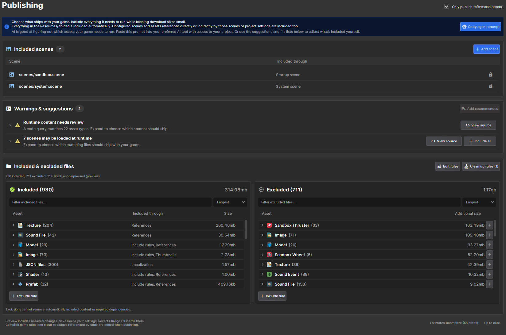

# Publishing

## Only Publish Referenced Assets

With **Only publish referenced assets** enabled, your game only ships the assets it actually uses instead of everything in your project. This keeps dev assets and unreleased content out of downloads.

You'll find the option in **Project Settings > Publishing**, and in the **Review Published Content** step of the publishing wizard. Both show a preview of what will be included and excluded before you upload.



:::info
New projects have this enabled by default. Existing projects keep publishing all assets until you enable it.
:::

### What gets included

These are included automatically, along with everything they reference directly or indirectly:

* Scenes configured in Game Setup (startup, map startup, dedicated server and system scenes)
* Assets referenced by your project settings
* Everything in the `Resources/` folder
* Anything matching your **Resource Files** rules

For example, a prefab in `Assets/Resources/` brings its models, materials and textures with it, even if they live outside that folder.

### Assets loaded from code

Code isn't scanned for dependencies. If you load an asset from code that nothing else references, it won't be published unless you include it yourself. There are two ways to do that:

* Put it in the `Resources/` folder at the root of your assets. Everything in there is included.
* Add a rule to **Resource Files**.

`Resources/` is just a publishing convention, so load paths keep the folder name:

```csharp
var hat = Model.Load( "resources/models/hat.vmdl" );
```

Only the top-level `Resources/` folder counts. `Assets/old/Resources/` is not included automatically.

### Warnings & suggestions

The **Warnings & suggestions** list above the preview flags assets your game might need but that are currently excluded. It picks up paths from your code, simple interpolated paths like `$"crabs/crab{number}.vmdl"`, and `ResourceLibrary.GetAll<T>()` queries.

Click **Include** on a warning to add its suggested rule, or **Add recommended** to add all of them at once. These are suggestions only, so review them before publishing.

### Resource Files rules

Rules are matched in order and the last matching rule wins. An ordinary path or wildcard includes; prefix it with `!` to exclude.

```text
scenes/*.scene
!scenes/dev*.scene
!scenes/tests/
scenes/dev_tutorial.scene
```

This includes every scene except dev and test scenes, then adds the tutorial back.

* `*` and `?` are wildcards, and `*` can span folders
* A trailing `/` matches a folder's contents
* `#` and `//` start comment lines

Exclusions only apply to Resource Files rules. Configured scenes, the `Resources/` folder and dependencies of included assets still ship. The preview lists anything that is **Required despite exclusions**, along with the reason.
